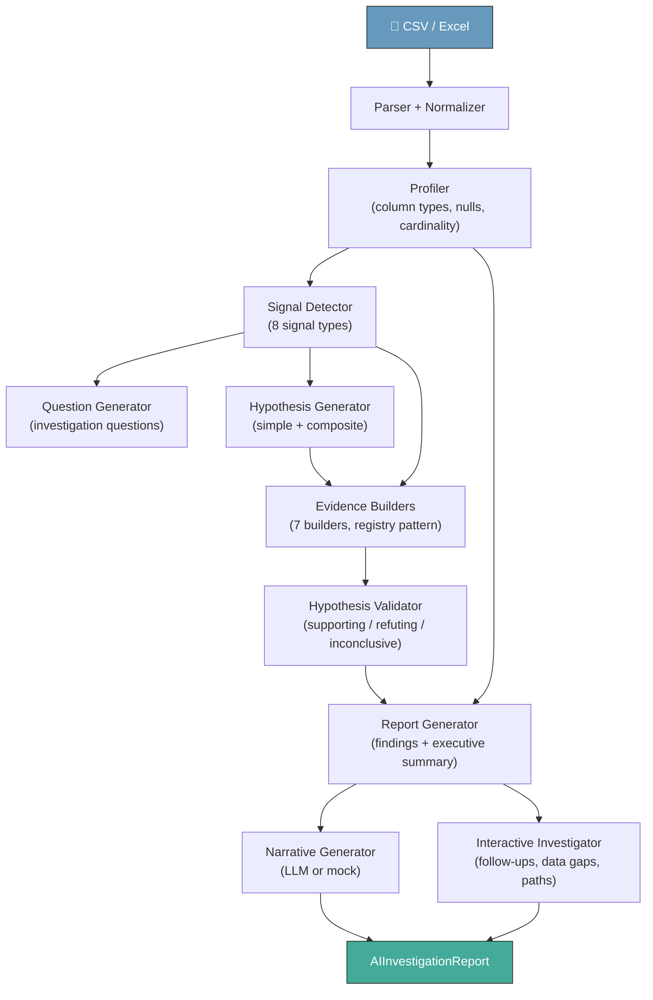

# System Architecture

## Full Pipeline (Phase 1–8)



## Layered Architecture

```
┌─────────────────────────────────────────────┐
│           AIInvestigationReport             │  ← wraps all layers
├─────────────────────────────────────────────┤
│  Narrative (LLM)  │  Interactive (Phase 8)  │  ← generative + forward-looking
├─────────────────────────────────────────────┤
│         InvestigationReport                 │  ← deterministic
├─────────────────────────────────────────────┤
│  Findings  │  Executive Summary  │  Evidence│
├─────────────────────────────────────────────┤
│  Hypothesis Validator  │  Evidence Builders │
├─────────────────────────────────────────────┤
│  Question Gen  │  Hypothesis Gen            │
├─────────────────────────────────────────────┤
│  Signal Detector (8 types)                  │
├─────────────────────────────────────────────┤
│  Profiler  │  Quality  │  Parser            │
├─────────────────────────────────────────────┤
│              Raw Dataset                    │
└─────────────────────────────────────────────┘
```

## Components

### Data Ingestion (Phase 1)

- CSV / Excel parsing
- Column name normalization
- Schema validation

### Data Understanding (Phase 2)

- Column type inference (numeric, categorical, datetime, boolean, text)
- Identifier detection
- Missing value analysis
- Cardinality analysis

### Signal Detection (Phase 3)

8 signal types:
- `HIGH_MISSING_RATE` — columns with >20% nulls
- `HIGH_CARDINALITY` — text/categorical columns with >90% unique values
- `OUTLIER_DETECTED` — numeric columns with IQR outliers
- `INCREASING_TREND` / `DECREASING_TREND` — time-series direction
- `HIGH_CONCENTRATION` — one category dominates (>70% share)
- `RIGHT_SKEWED` / `LEFT_SKEWED` — mean/median asymmetry
- `LOW_VARIANCE` — coefficient of variation <5%

### Question Generation (Phase 4)

Maps each detected signal to investigation questions (question bank pattern).
Questions are categorized: observation, validation.
Priorities derived from signal severity.

### Hypothesis Generation (Phase 5)

- **Simple hypotheses**: one per signal
- **Composite hypotheses**: generated when multiple signal types co-occur
  (e.g., CONCENTRATION + RIGHT_SKEW → "business structurally dependent on few entities")

### Evidence Generation (Phase 6)

7 evidence builders, registry pattern:
- `distribution` — mean, median, std, skewness
- `outlier` — count, ratio, IQR bounds
- `trend` — first/last values, growth rate
- `concentration` — top-1 and top-N share
- `missing_rate` — null percentage
- `cardinality` — unique count and ratio
- `variance` — coefficient of variation

Each builder is registered by `SignalType` and produces structured `Evidence` objects.

### Hypothesis Validation (Phase 6)

- Classifies evidence as **supporting**, **contradicting**, or **neutral**
  using per-SignalType numeric threshold rules
- Determines hypothesis status: `SUPPORTED`, `REFUTED`, or `INCONCLUSIVE`
- Adjusts confidence: REFUTED → LOW; otherwise preserved

### Investigation Report (Phase 6)

- **Findings**: templated business narratives per (SignalType × Status) combination
- **Executive Summary**: counts, risk level, confidence level, top-priority findings
- **Dataset Summary**: row/column counts, column-type breakdown
- **Next Steps**: deduplicated recommendations from all findings

### Narrative Generation (Phase 7)

- `NarrativeGenerator` Protocol — provider-agnostic interface
- `MockNarrativeGenerator` — deterministic, no API calls (default)
- Future: Anthropic, OpenAI, etc. behind same interface
- Produces `Narrative`: executive summary, key findings, evidence summary,
  business impact, recommendations
- Versioned prompt contracts in `app/prompts/`

### Interactive Investigation (Phase 8)

- **Follow-up questions**: drill-down, alternative explanations,
  cross-pattern questions, data-gap questions
- **Data gaps**: what additional data would strengthen conclusions,
  with suggested sources
- **Investigation paths**: step-by-step guided exploration for each
  supported finding
- **Unresolved areas**: inconclusive hypotheses needing more data

## Design Patterns

### Registry Pattern

Signal detectors and evidence builders are registered by `SignalType`.
Adding a new signal type requires:
1. A new `SignalType` enum value
2. A new evidence builder
3. Registration in the `EVIDENCE_BUILDERS` dict

No existing code changes needed.

### Protocol Pattern (Phase 7)

```python
class NarrativeGenerator(Protocol):
    def generate(self, report: InvestigationReport) -> tuple[Narrative, ModelMetadata]:
        ...
```

Pipeline depends on the Protocol, never on a concrete provider.
Switching providers is a config change (`LLM_MODE`), not a code change.

### Wrapping, Not Extending

`AIInvestigationReport` **wraps** `InvestigationReport` rather than extending it.
Deterministic and generative outputs are independently testable and versionable.

## Separation of Concerns

| Layer | Responsibility |
|---|---|
| `app/schemas/` | Pure data models, no business logic |
| `app/services/` | Business logic, analysis, generation |
| `app/prompts/` | Versioned prompt contracts (input/output/traceability) |
| `app/api/` | Request handling, orchestration |
| `tests/` | 162 tests, 23 fixtures |
