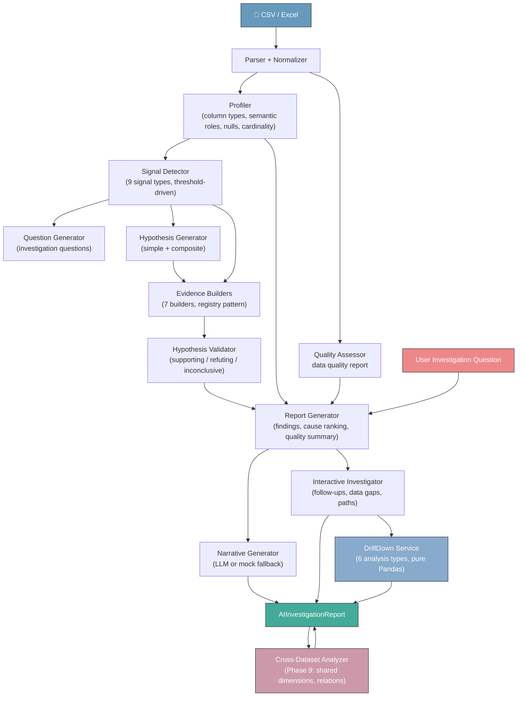

# System Architecture

## Full Pipeline



## Layered Architecture

```
┌─────────────────────────────────────────────┐
│           AIInvestigationReport             │  ← wraps all layers
├─────────────────────────────────────────────┤
│  Narrative (LLM)  │  Interactive (Phase 8)  │  ← generative + forward-looking
│  DrillDown Results │  Cross-Dataset Graph   │  ← interactive + multi-dataset
├─────────────────────────────────────────────┤
│         InvestigationReport                 │  ← deterministic
├─────────────────────────────────────────────┤
│  Findings  │  Cause Ranking  │  Quality    │
│  Executive Summary  │  Evidence            │
├─────────────────────────────────────────────┤
│  Hypothesis Validator  │  Evidence Builders │
│  Cause Ranker                             │
├─────────────────────────────────────────────┤
│  Question Gen  │  Hypothesis Gen            │
├─────────────────────────────────────────────┤
│  Signal Detector (9 types)                  │
├─────────────────────────────────────────────┤
│  Profiler  │  Quality  │  Column Selection  │
│  Thresholds (centralized)                   │
├─────────────────────────────────────────────┤
│  Parser  │  Normalizer  │  Validator       │
├─────────────────────────────────────────────┤
│              Raw Dataset                     │
└─────────────────────────────────────────────┘
```

## Components

### Data Ingestion

- CSV / Excel parsing (`parser.py`)
- Column name normalization (`normalizer.py`)
- Schema validation (`validator.py`)
- Data quality assessment (`quality.py`) — produces `DataQualityReport` with risk level, issue count, and warnings

### Data Profiling

- Column type inference: numeric, categorical, datetime, boolean, text
- Semantic role assignment (`column_selection.py`): metric, dimension, time, entity, identifier
- Identifier detection (excluded from signal detection)
- Missing value analysis
- Cardinality analysis

### Threshold Management

All statistical thresholds are centralized in `thresholds.py`:

- `MISSING_RATE_WARNING = 20.0`
- `HIGH_CARDINALITY_RATIO = 0.9`
- `OUTLIER_IQR_MULTIPLIER = 1.5`
- `TREND_MIN_R_SQUARED = 0.25`
- `TREND_MIN_ABS_GROWTH_RATE = 0.05`
- `SKEWNESS_WARNING_ABS = 0.5`
- `CONCENTRATION_TOP1_HIGH = 0.7`
- `LOW_VARIANCE_CV = 0.05`

This avoids magic numbers scattered across the codebase and makes tuning a single-file change.

### Signal Detection

9 signal types across 6 detection groups:

| Detection function | Signal type | Method | Threshold |
|---|---|---|---|
| `detect_missing_rate` | `HIGH_MISSING_RATE` | Null percentage per column | > 20% |
| `detect_cardinality` | `HIGH_CARDINALITY` | Unique-to-total ratio on text/categorical columns | > 90% |
| `detect_outliers` | `OUTLIER_DETECTED` | IQR method (Q1 - 1.5×IQR, Q3 + 1.5×IQR) | outlier_count > 0, min sample 4 |
| `detect_trends` | `INCREASING_TREND` / `DECREASING_TREND` | Linear regression slope + growth rate + R² | growth ≥ 5%, R² ≥ 0.25 (or < 4 points) |
| `detect_concentration` | `HIGH_CONCENTRATION` | Top-1 category share of a metric | > 70% |
| `detect_distribution` | `RIGHT_SKEWED` / `LEFT_SKEWED` | Skewness of numeric column | abs(skewness) > 0.5 |
| `detect_distribution` | `LOW_VARIANCE` | Coefficient of variation | CV < 5% |

Trend detection uses `r_squared` reliability metrics to avoid false positives from non-zero slopes on noisy data.

### Question Generation

Maps each detected signal to investigation questions (question bank pattern).
Questions are categorized: observation, validation.
Priorities derived from signal severity.

### Hypothesis Generation

- **Simple hypotheses**: one per signal
- **Composite hypotheses**: generated when multiple signal types co-occur
  (e.g., CONCENTRATION + RIGHT_SKEW → "business structurally dependent on few entities")

### Evidence Generation

7 evidence builders using the registry pattern:

| Builder | Signal types served | Key metrics |
|---|---|---|
| `distribution` | RIGHT_SKEWED, LEFT_SKEWED | mean, median, std, skewness |
| `outlier` | OUTLIER_DETECTED | count, ratio, IQR bounds |
| `trend` | INCREASING_TREND, DECREASING_TREND | first/last values, growth rate, R² |
| `concentration` | HIGH_CONCENTRATION | top-1 and top-N share, top category |
| `missing_rate` | HIGH_MISSING_RATE | null percentage, null count |
| `cardinality` | HIGH_CARDINALITY | unique count and ratio |
| `variance` | LOW_VARIANCE | coefficient of variation |

Each builder is registered by `SignalType` in the `EVIDENCE_BUILDERS` dict and produces structured `Evidence` objects with `method`, `threshold`, `sample_size`, `strength`, and `limitation` fields.

### Hypothesis Validation

- Classifies evidence as **supporting**, **contradicting**, or **neutral**
  using per-SignalType numeric threshold rules
- Determines hypothesis status: `SUPPORTED`, `REFUTED`, or `INCONCLUSIVE`
- Adjusts confidence: REFUTED → LOW; otherwise preserved

### Cause Candidate Ranking

`cause_ranker.py` generates a ranked list of likely explanations from validated findings:

- Supporting evidence count increases score
- Higher confidence findings score higher
- Findings related to the user's investigation question score higher
- Contradicting evidence or data quality limitations decrease score
- Multiple signals pointing to the same explanation increase score
- Results never claim guaranteed causation

### Investigation Report

- **Findings**: templated business narratives per (SignalType × Status) combination
- **Executive Summary**: counts, risk level, confidence level, top-priority findings
- **Dataset Summary**: row/column counts, column-type breakdown, semantic roles
- **Quality Summary**: data quality risk level, issue count, key warnings
- **Cause Candidates**: 3–5 ranked explanations with evidence and limitations
- **Next Steps**: deduplicated recommendations from all findings
- Findings include `evidence_strength` and `uncertainty_notes` for calibrated interpretation

### Narrative Generation

- `NarrativeGenerator` Protocol — provider-agnostic interface
- `MockNarrativeGenerator` — deterministic, no API calls (default)
- `LLMNarrativeGenerator` — calls external LLM (30-second timeout)
- Fallback: if LLM fails, pipeline falls back to `MockNarrativeGenerator` without blocking the deterministic report
- Produces `Narrative`: executive summary, key findings, evidence summary,
  business impact, recommendations, plain-language summary, confidence notes
- Versioned prompt contracts in `app/prompts/`

### Interactive Investigation

- **Follow-up questions**: drill-down, alternative explanations,
  cross-pattern questions, data-gap questions
- **Data gaps**: what additional data would strengthen conclusions,
  with suggested sources
- **Investigation paths**: step-by-step guided exploration for each
  supported finding
- **Unresolved areas**: inconclusive hypotheses needing more data

### DrillDown Service

`drilldown.py` — runnable follow-up analyses executed on user demand.

6 analysis types, each dispatching by signal type:

| Signal type | Analysis | What it does |
|---|---|---|
| OUTLIER_DETECTED | `tail_records` | IQR-based outlier records, contribution share |
| RIGHT_SKEWED / LEFT_SKEWED | `tail_records` | High/low tail records, value concentration |
| INCREASING/DECREASING_TREND | `trend_by_dimension` | Trend broken down by a dimension |
| HIGH_CONCENTRATION | `top_category_vs_rest` | Top category vs rest comparison |
| HIGH_MISSING_RATE | `missingness_by_dimension` | Missing value concentration by dimension |
| HIGH_CARDINALITY | `cardinality_distribution` | Value frequency distribution, 80% coverage threshold |
| LOW_VARIANCE | `low_variance_distribution` | CV, unique value count, most common values |

All analyses are pure Pandas computations — no LLM calls, <1 second execution.
Results are appended to the report's `drilldown_steps` list; the original
deterministic report is never modified.

### Cross-Dataset Analysis (Phase 9)

`cross_dataset_analyzer.py` — analyzes relationships between a primary
dataset and optional secondary datasets.

- **Shared dimensions**: columns present across datasets
- **Cross-dataset relations**: correlated trends, shared entities, complementing signals
- **Investigation graph**: structured representation of inter-dataset relationships

The pipeline runs a light version (profile + signal detection) on each
secondary dataset, then feeds primary and secondary outputs into the analyzer.
Results are stored as `InvestigationGraph` in `AIInvestigationReport`.

## API Layer

| Endpoint | Method | Purpose |
|---|---|---|
| `/upload/` | POST | Upload single file, start pipeline |
| `/upload/investigate/` | POST | Upload primary + optional secondary files with investigation question |
| `/task/{task_id}` | GET | Poll task status, progress, and result |
| `/task/{task_id}/follow-ups/{question_index}/drilldown` | POST | Run drill-down analysis for a follow-up question |

File uploads use FastAPI `BackgroundTasks` — the API returns a `task_id`
immediately, and the pipeline runs asynchronously. Progress is written to
the database at each stage.

## Design Patterns

### Registry Pattern

Evidence builders are registered by `SignalType` in a dict:

```python
EVIDENCE_BUILDERS = {
    SignalType.HIGH_CONCENTRATION: build_concentration_evidence,
    SignalType.RIGHT_SKEWED: build_distribution_evidence,
    ...
}
```

Adding a new signal type requires:
1. A new `SignalType` enum value
2. A new evidence builder function
3. Registration in the `EVIDENCE_BUILDERS` dict

No existing code changes needed.

### Protocol Pattern

```python
class NarrativeGenerator(Protocol):
    def generate(self, report: InvestigationReport) -> tuple[Narrative, ModelMetadata]:
        ...
```

Pipeline depends on the Protocol, never on a concrete provider.
Switching providers is a config change (`LLM_MODE`), not a code change.

### Wrapping, Not Extending

`AIInvestigationReport` **wraps** `InvestigationReport` rather than extending it.
Deterministic and generative outputs are independently testable and versionable.
The deterministic report is never modified by LLM output.

### Centralized Thresholds

All statistical thresholds live in `thresholds.py`. This ensures:
- Tuning is a single-file change
- No magic numbers in detection or validation code
- Thresholds are consistent between signal detection and hypothesis validation

## Separation of Concerns

| Layer | Responsibility |
|---|---|
| `app/schemas/` | Pure data models, no business logic |
| `app/services/` | Business logic, analysis, generation |
| `app/services/evidence/` | Evidence builders (registry pattern) |
| `app/prompts/` | Versioned prompt contracts (input/output/traceability) |
| `app/api/` | Request handling, orchestration |
| `app/models/` | Database models (SQLAlchemy) and enums |
| `app/core/` | Configuration, logging |
| `app/db/` | Database connection and session management |
| `tests/` | 206 tests, 22 fixtures |

## Deterministic vs LLM Boundary

| Stage | Type | Fallback |
|---|---|---|
| Parsing → Profiling → Signals → Questions → Hypotheses → Evidence → Validation → Report | Deterministic (Pandas) | N/A |
| Narrative | LLM | MockNarrativeGenerator |
| Interactive Investigation | Deterministic | N/A |
| DrillDown Analysis | Deterministic (Pandas) | N/A |
| Cross-Dataset Analysis | Deterministic | N/A |

The LLM only rewrites the deterministic report in natural language.
If the LLM call fails (30-second timeout), the pipeline falls back to
`MockNarrativeGenerator` and the task still completes with full
deterministic results.
